# Database Analysis — obms-api

> **Security notice:** Connection strings, server names, and credentials are not exposed in this document.  
> Database name referenced in scripts: `OBMSINDIA` / `OBMSINDIAUАТ` (masked where appropriate).

---

## Database Engine & ORM

| Property | Value |
|---|---|
| **Engine** | Microsoft SQL Server (T-SQL syntax throughout) |
| **ORM** | Entity Framework Core (DbContext pattern inferred from C# snippets in `.md` files — `_oBMSDbContext`) |
| **Schema** | `dbo` (default schema used on all objects) |
| **Management tool referenced** | SQL Server Management Studio (SSMS) |
| **Crystal Reports integration** | Yes — several SQL files are Crystal Report "Add Command" queries |

---

## Table Inventory

### Core Employee Tables

#### `Employee`
Purpose: Master record for every employee.

| Column | Type | Notes |
|---|---|---|
| EMP_ID | INT (PK, IDENTITY) | Primary key |
| EMP_CODE | NVARCHAR | Unique employee code (e.g. `FWGG000368`) |
| EMP_ROLE | NVARCHAR | `'Staff'` or field-worker role |
| EMP_NAME | NVARCHAR | Full name |
| EMP_ADDRESS1–2 | NVARCHAR | Address lines |
| EMP_POST_CODE | NVARCHAR | |
| EMP_TOWN | NVARCHAR | |
| EMP_STATE | NVARCHAR | |
| EMP_NATIONAL | NVARCHAR | Nationality |
| EMP_PHONE | NVARCHAR | |
| EMP_MOBILEPHONE | NVARCHAR | |
| EMP_HGH_EDU | NVARCHAR | Highest education |
| EM_WORK_EXP | NVARCHAR | Work experience |
| EMP_DATE_OF_BIRTH | DATETIME | Used for PF age check (≥55 = EPF exempt) |
| EMP_IC_OLD / EMP_IC_NEW | NVARCHAR | IC numbers |
| EMP_IC_COLOR | NVARCHAR | |
| EMP_PASSPORT_NO | NVARCHAR | |
| EMP_SEX | NVARCHAR | |
| EMP_RACE | NVARCHAR | |
| EMP_MARTIAL_STATUS | NVARCHAR | |
| EMP_SPOUSE_NAME | NVARCHAR | |
| EMP_SP_IC | NVARCHAR | |
| EMP_NO_CHILD | NVARCHAR | |
| EMP_SP_WORK | NVARCHAR | |
| EMP_PER_NAME_CONTACT | NVARCHAR | Emergency contact name |
| EMP_CONTACT_ADDRESS1–2 | NVARCHAR | Emergency contact address |
| EMP_CONTACT_POST_CODE | NVARCHAR | |
| EMP_CONTACT_TOWN | NVARCHAR | |
| EMP_CONTACT_STATE | NVARCHAR | |
| EMP_CONTACT_TELEPHONE | NVARCHAR | |
| EMP_BRANCH_CODE | NVARCHAR | FK → BranchMaster.Code |
| EMP_CLIENT | NVARCHAR | FK → ClientMaster.Code |
| OldBranch | NVARCHAR | Previous branch code |
| TransferDate | DATETIME | Date of last branch transfer |
| HasTransfered | BIT | Transfer flag |
| EMP_CITIZEN | NVARCHAR | |
| EMP_CHECKLIST | NVARCHAR | |
| NewSalaryStructure | NVARCHAR/BIT | |
| KDNVetting | NVARCHAR/BIT | |
| SalaryStructure1000_3h | NVARCHAR/BIT | |
| IndianState | NVARCHAR | State for Professional Tax slab matching |
| UANNumber | NVARCHAR | Universal Account Number (EPF) |
| PFAccountNumber | NVARCHAR | PF account number |
| CB_Basic | DECIMAL(18,2) | Commercial Breakdown — Basic salary |
| CB_DA | DECIMAL(18,2) | Dearness Allowance |
| CB_HRA | DECIMAL(18,2) | House Rent Allowance |
| CB_OtherAllowances | DECIMAL(18,2) | Other allowances |
| CB_AdvanceStatutoryBonus | DECIMAL(18,2) | Advance statutory bonus |
| CB_Leaves | DECIMAL(18,2) | Leave encashment component |
| CB_NH | DECIMAL(18,2) | National Holiday component |
| CB_SubTotal | DECIMAL(18,2) | Sum of all CB components |
| JoinDate | DATETIME NULL | *(migration added)* Original company join date |
| TDSApplicable | BIT NOT NULL DEFAULT 0 | *(migration added)* Employee-level TDS flag |
| LASTUPDATE | DATETIME | |
| LastUpdatedBy | NVARCHAR(20) | |

---

#### `EmploymentDetails`
Purpose: Employment terms per employee (pay rates, dates, job title).

| Column | Type | Notes |
|---|---|---|
| EMPPAY_CODE | NVARCHAR(50) | PK / FK → Employee.EMP_CODE |
| EMPPAY_BRANCHCODE | NVARCHAR(20) | Branch code |
| EMPPAY_JOB_TITLE | NVARCHAR(50) | |
| EMPPAY_CATEGORY | NVARCHAR(50) | |
| EMPPAY_DATE_JOINED | DATETIME | |
| EMPPAY_DATE_CONFIRM | DATETIME | |
| EMPPAY_DATE_PROMOTION | DATETIME | |
| EMPPAY_DATE_RESIGNED | DATETIME | |
| EMPPAY_BASIC_RATE | FLOAT | Basic rate of pay |
| SALARYLAB | DECIMAL(18,2) | |
| ATTENDANCEALLOWANCE | DECIMAL(18,2) | |
| NewStructureATTENDANCEALLOWANCE | DECIMAL(18,2) | |
| SpecialAllowance | DECIMAL(18,2) | |
| AttendanceAllowanceWorkingDays | DECIMAL(18,2) | |
| AttendanceAllowanceFollowCalendar | NVARCHAR(1) | |
| LASTUPDATE | DATETIME | |
| LastUpdatedBy | NVARCHAR(20) | |

---

#### `EmployeeSalaryDetails`
Purpose: Statutory deduction flags and bank/fund details per employee.

| Column | Type | Notes |
|---|---|---|
| EMPFL_CODE | NVARCHAR(50) | PK / FK → Employee.EMP_CODE |
| EMPFL_BRANCHCODE | NVARCHAR(20) | |
| EMPFL_BANK | NVARCHAR(50) | Bank name |
| EMPFL_BK_ACCNO | NVARCHAR(25) | Bank account number |
| EMPFL_TAX_NO | NVARCHAR(25) | Tax reference number |
| EMPFL_EPFNO | NVARCHAR(25) | EPF member number |
| EMPFL_EPF8Pa | BIT | EPF 8% flag |
| EMPFL_SOSCO_NO | NVARCHAR(25) | SOCSO number |
| EPFDETECT | BIT NOT NULL DEFAULT 0 | Enable PF deduction |
| PAYMODE | NVARCHAR(20) | Payment mode |
| SOCSODETECT | BIT NOT NULL DEFAULT 0 | Enable ESI/SOCSO deduction |
| TMPGUARD | BIT NOT NULL DEFAULT 0 | Temporary guard flag |
| DETECTBYND55 | BIT NOT NULL DEFAULT 0 | Age >55 detection |
| INCOMETAXDETECT | BIT | Enable Professional Tax |
| EMP_SP_TEL_NO | NVARCHAR(20) | Spouse telephone |
| OT | NVARCHAR(10) | Overtime flag |
| LASTUPDATE | DATETIME | |
| LastUpdatedBy | NVARCHAR(20) | |

---

#### `EmployeeHistory`
Purpose: Full snapshot of employee + employment + salary state at each branch period. Created on every branch transfer.

| Column | Type | Notes |
|---|---|---|
| EMP_HISTORY_ID | INT (PK, IDENTITY) | |
| EMP_ID | INT | FK → Employee.EMP_ID |
| EMP_CODE | NVARCHAR | FK ref to Employee |
| EMP_ROLE | NVARCHAR | Snapshot |
| EMP_NAME | NVARCHAR | Snapshot |
| EMP_BRANCH_CODE | NVARCHAR | Branch at time of snapshot |
| OldBranch | NVARCHAR | |
| TransferDate | DATETIME | |
| HasTransfered | BIT | |
| *(all Employee columns)* | — | Full employee snapshot |
| EMPPAY_JOB_TITLE | NVARCHAR | From EmploymentDetails |
| EMPPAY_CATEGORY | NVARCHAR | |
| EMPPAY_DATE_JOINED | DATETIME | |
| EMPPAY_DATE_CONFIRM | DATETIME | |
| EMPPAY_DATE_PROMOTION | DATETIME | |
| EMPPAY_DATE_RESIGNED | DATETIME | |
| EMPPAY_BASIC_RATE | FLOAT | |
| SALARYLAB | DECIMAL(18,2) | |
| ATTENDANCEALLOWANCE | DECIMAL(18,2) | |
| NewStructureATTENDANCEALLOWANCE | DECIMAL(18,2) | |
| SpecialAllowance | DECIMAL(18,2) | |
| AttendanceAllowanceWorkingDays | DECIMAL(18,2) | |
| AttendanceAllowanceFollowCalendar | NVARCHAR(1) | |
| EMPFL_BANK | NVARCHAR | From EmployeeSalaryDetails |
| EMPFL_BK_ACCNO | NVARCHAR | |
| EMPFL_TAX_NO | NVARCHAR | |
| EMPFL_EPFNO | NVARCHAR | |
| EMPFL_EPF8Pa | BIT | |
| EMPFL_SOSCO_NO | NVARCHAR | |
| EPFDETECT | BIT | |
| PAYMODE | NVARCHAR | |
| SOCSODETECT | BIT | |
| TMPGUARD | BIT | |
| DETECTBYND55 | BIT | |
| INCOMETAXDETECT | BIT | |
| Emp_StartDate | DATETIME NULL | *(migration added)* Branch period start |
| Emp_EndDate | DATETIME NULL | *(migration added)* Branch period end; NULL = active |
| JoinDate | DATETIME NULL | *(migration added)* Original company join date |
| LASTUPDATE | DATETIME | |
| LastUpdatedBy | NVARCHAR(20) | |

---

#### `EmployeeSalaryDetailHistory`
Purpose: Per-branch snapshot of EmployeeSalaryDetails for history/audit.

| Column | Type |
|---|---|
| EMPFL_HISTORY_ID | INT (PK, IDENTITY) |
| EMP_ID | INT — FK → Employee.EMP_ID |
| EMPFL_CODE | NVARCHAR(50) |
| EMPFL_BRANCHCODE | NVARCHAR(20) |
| EMPFL_BANK | NVARCHAR(50) |
| EMPFL_BK_ACCNO | NVARCHAR(25) |
| EMPFL_TAX_NO | NVARCHAR(25) |
| EMPFL_EPFNO | NVARCHAR(25) |
| EMPFL_EPF8Pa | BIT |
| EMPFL_SOSCO_NO | NVARCHAR(25) |
| EPFDETECT | BIT NOT NULL DEFAULT 0 |
| PAYMODE | NVARCHAR(20) |
| SOCSODETECT | BIT NOT NULL DEFAULT 0 |
| TMPGUARD | BIT NOT NULL DEFAULT 0 |
| DETECTBYND55 | BIT NOT NULL DEFAULT 0 |
| INCOMETAXDETECT | BIT |
| EMP_SP_TEL_NO | NVARCHAR(20) |
| OT | NVARCHAR(10) |
| Emp_StartDate | DATETIME NULL |
| Emp_EndDate | DATETIME NULL |
| LASTUPDATE | DATETIME |
| LastUpdatedBy | NVARCHAR(20) |

---

#### `EmploymentDetailsHistory`
Purpose: Per-branch snapshot of EmploymentDetails for history/audit.

| Column | Type |
|---|---|
| EMPPAY_HISTORY_ID | INT (PK, IDENTITY) |
| EMP_ID | INT — FK → Employee.EMP_ID |
| EMPPAY_CODE | NVARCHAR(50) |
| EMPPAY_BRANCHCODE | NVARCHAR(20) |
| EMPPAY_JOB_TITLE | NVARCHAR(50) |
| EMPPAY_CATEGORY | NVARCHAR(50) |
| EMPPAY_DATE_JOINED | DATETIME |
| EMPPAY_DATE_CONFIRM | DATETIME |
| EMPPAY_DATE_PROMOTION | DATETIME |
| EMPPAY_DATE_RESIGNED | DATETIME |
| EMPPAY_BASIC_RATE | FLOAT NOT NULL DEFAULT 0 |
| SALARYLAB | DECIMAL(18,2) NOT NULL DEFAULT 0 |
| ATTENDANCEALLOWANCE | DECIMAL(18,2) |
| NewStructureATTENDANCEALLOWANCE | DECIMAL(18,2) NOT NULL DEFAULT 0 |
| SpecialAllowance | DECIMAL(18,2) NOT NULL DEFAULT 0 |
| AttendanceAllowanceWorkingDays | DECIMAL(18,2) |
| AttendanceAllowanceFollowCalendar | NVARCHAR(1) |
| Emp_StartDate | DATETIME NULL |
| Emp_EndDate | DATETIME NULL |
| LASTUPDATE | DATETIME |
| LastUpdatedBy | NVARCHAR(20) |

---

### Payroll Tables

#### `PaySlip` (also referenced as `PaySlips`)
Purpose: Monthly payroll record per employee per period.

| Column | Type | Notes |
|---|---|---|
| ID | INT (PK, IDENTITY) | |
| EmployeeID | INT | FK → Employee.EMP_ID |
| Period | DATE | Last day of the salary month (EOMONTH) |
| BasicSalary | DECIMAL | |
| BasicSalaryRate | DECIMAL | |
| BasicSalaryDays | DECIMAL | Working days used for proration |
| PerDaySalary | DECIMAL(10,4) | *(migration added)* GrossPay / CalendarDays |
| EarnedSalary | DECIMAL(10,2) | *(migration added)* BasicSalaryDays × PerDaySalary |
| GrossPay | DECIMAL(10,2) | *(migration added)* Sum of all CB components |
| PF | DECIMAL(10,2) | *(migration added)* Employee PF contribution (12% of PFWage) |
| PFWage | DECIMAL(10,2) | *(migration added)* Prorated Basic+DA+OtherAllowances, capped at PFConfig limit |
| EPFDeductionAmount | DECIMAL | Legacy Malaysia-era EPF value |
| EPFEmployerContribution | DECIMAL | Employer EPF share |
| ESI | DECIMAL(10,2) | *(migration added)* Employee ESI contribution (0.75% of ESIWage) |
| ESIWage | DECIMAL(10,2) | *(migration added)* EarnedSalary − CB_AdvanceStatutoryBonus |
| SOCSODeductionAmount | DECIMAL | Legacy Malaysia-era SOCSO value |
| SOCSOEmployerContribution | DECIMAL | |
| PTax | DECIMAL(10,2) | *(migration added)* Professional Tax from slab lookup |
| TDS | DECIMAL(10,2) | *(migration added)* Tax Deducted at Source |
| LWF | DECIMAL(10,2) | *(migration added)* Labour Welfare Fund (₹30 in December) |
| TotalDeduction | DECIMAL(10,2) | *(migration added)* Sum of all deductions |
| NetPay | DECIMAL(10,2) | *(migration added)* GrossPay − TotalDeduction |
| DailyAdvanceRecovery | DECIMAL | |
| MonthlyAdvanceRecovery | DECIMAL | |
| SpecialAdvanceRecovery | DECIMAL | |
| UniformIssueRecovery | DECIMAL | |
| LoanRecovery | DECIMAL | |
| MiscDeduction | DECIMAL | |
| AttendanceAllowance | DECIMAL | |
| SpecialAllowance | DECIMAL | |
| Bonus | DECIMAL | |
| OverTimeSalary | DECIMAL | |
| LastUpdate | DATETIME | |
| LastUpdatedBy | NVARCHAR | |

---

#### `PaySlipAudit`
Purpose: Audit trail mirror of PaySlip — same column structure with all migration-added columns mirrored (PTax, TDS, PF, PFWage, ESI, ESIWage, GrossPay, LWF, EarnedSalary, PerDaySalary, TotalDeduction, NetPay).

---

### Attendance Tables

#### `Attendances`
Purpose: Monthly attendance header per employee.

| Column | Type | Notes |
|---|---|---|
| ID | INT (PK) | |
| EmployeeID | INT | FK → Employee.EMP_ID |
| Period | DATE | End of month date |

#### `AttendanceDetails`
Purpose: Daily attendance records.

| Column | Type | Notes |
|---|---|---|
| ID | INT (PK) | |
| AttendanceID | INT | FK → Attendances.ID |
| AttendanceDate | DATE | Individual calendar date |
| Type | INT | Attendance type code (1–5, 8–17 = working; 6 = unpaid leave; 7 = absent) |

---

### Agreement / Client Contract Tables

#### `Agreement`
Purpose: Service agreement between a Branch and a Client, optionally at a specific WorkPlace.

| Column | Type | Notes |
|---|---|---|
| ID | INT (PK, IDENTITY) | |
| Branch | NVARCHAR(20) | FK → BranchMaster.Code |
| Client | NVARCHAR(50) | FK → ClientMaster.Code |
| WorkPlace | NVARCHAR | Optional workplace |
| AgreementDate | DATETIME | Effective date |
| Period | NVARCHAR(50) NULL | *(migration added)* |
| IsValid | BIT | 1/NULL = active; 0 = old history row |
| LASTUPDATE | DATETIME | |

#### `AgreementDetails`
Purpose: Line-item details of a service agreement (rates, terms, discount).

| Column | Type | Notes |
|---|---|---|
| *(PK implied)* | INT (IDENTITY) | |
| AgreementType | NVARCHAR(200) NULL DEFAULT 'N' | *(migration added)* |
| MonthDays | INT NOT NULL DEFAULT 0 | *(migration added)* |
| DiscountHour | DECIMAL(10,2) NOT NULL | *(migration changed from INT)* Fractional discount days |
| *(other columns implied by context)* | | |

---

### Finance / Invoice Tables

#### `ClientInvoice`
Purpose: Sales invoices raised to clients.

| Column | Type | Notes |
|---|---|---|
| ID | INT (PK) | Referenced as `ClientInvoiceID` in CreditNote/DebitNote |
| Branch | NVARCHAR | FK → BranchMaster.Code |
| InvoiceDate | DATETIME | |
| ServiceCharges | DECIMAL | Revenue component |
| TaxAmount | DECIMAL | |
| Discount | DECIMAL | |
| IsDeleted | NVARCHAR(1) | `'N'` = active |
| *(other columns implied)* | | |

#### `CreditorInvoice`
Purpose: Purchase/expense invoices from creditors.

| Column | Type | Notes |
|---|---|---|
| *(PK implied)* | INT (IDENTITY) | |
| *(core invoice columns implied)* | | |
| GSTPercentage | DECIMAL(5,2) NOT NULL DEFAULT 0 | *(migration added)* |
| GSTAmount | DECIMAL(18,2) NOT NULL DEFAULT 0 | *(migration added)* |
| CGSTPercentage | DECIMAL(5,2) NOT NULL DEFAULT 0 | *(migration added)* Intra-state CGST % |
| CGSTAmount | DECIMAL(18,2) NOT NULL DEFAULT 0 | *(migration added)* |
| SGSTPercentage | DECIMAL(5,2) NOT NULL DEFAULT 0 | *(migration added)* Intra-state SGST % |
| SGSTAmount | DECIMAL(18,2) NOT NULL DEFAULT 0 | *(migration added)* |
| IGSTPercentage | DECIMAL(5,2) NOT NULL DEFAULT 0 | *(migration added)* Inter-state IGST % |
| IGSTAmount | DECIMAL(18,2) NOT NULL DEFAULT 0 | *(migration added)* |
| TransactionType | NVARCHAR(1) NOT NULL DEFAULT 'I' | *(migration added)* 'I'=Intra-state, 'E'=Inter-state |
| TDSPercentage | DECIMAL(5,2) NOT NULL DEFAULT 0 | *(migration added)* |
| TDSAmount | DECIMAL(18,2) NOT NULL DEFAULT 0 | *(migration added)* |

#### `Receipts`
Purpose: Cash/payment receipts from clients.

| Column | Type | Notes |
|---|---|---|
| ID | INT (PK) | |
| Branch | NVARCHAR | |
| ReceiptDate | DATETIME | |
| ReceiptAmount | DECIMAL | |
| CreditNoteAmount | DECIMAL | Credit note portion applied |
| IsDeleted | BIT | |
| IsInvoiceAdjustment | BIT | Filters out invoice adjustments from P&L |
| PaymentFrom | NVARCHAR | Client reference |

#### `CreditNote`
Purpose: Credit notes issued to clients (reduces receivables).

| Column | Type | Notes |
|---|---|---|
| ID | INT (PK, IDENTITY) | |
| CreditNoteNo | NVARCHAR(50) NOT NULL | Unique (filtered index on IsDeleted=0) |
| Branch | NVARCHAR(20) NOT NULL | FK → BranchMaster.Code |
| Client | NVARCHAR(50) NOT NULL | FK → ClientMaster.Code |
| AgreementID | INT NULL | Optional FK → Agreement.ID |
| ClientInvoiceID | INT NULL | Optional FK → ClientInvoice.ID |
| CreditNoteDate | DATETIME NOT NULL | |
| CreditNoteAmount | DECIMAL(18,2) NOT NULL | Base amount before tax |
| TaxPercentage | DECIMAL(18,2) NOT NULL DEFAULT 0 | *(migration added)* |
| TaxAmount | DECIMAL(18,2) NOT NULL DEFAULT 0 | *(migration added)* |
| TotalAmount | DECIMAL(18,2) NOT NULL DEFAULT 0 | *(migration added)* |
| Reason | NVARCHAR(1000) NULL | |
| ReferenceInvoiceNo | NVARCHAR(50) NULL | |
| Status | NVARCHAR(20) NOT NULL DEFAULT 'Pending' | |
| ApprovalDate | DATETIME NULL | |
| ApprovedBy | NVARCHAR(50) NULL | |
| CreatedDate | DATETIME NOT NULL DEFAULT GETDATE() | |
| LastUpdatedDate | DATETIME NULL | |
| LastUpdatedBy | NVARCHAR(50) NULL | |
| IsDeleted | BIT NOT NULL DEFAULT 0 | |

#### `DebitNote`
Purpose: Debit notes (increases payables / adjustments).

| Column | Type | Notes |
|---|---|---|
| ID | INT (PK, IDENTITY) | |
| DebitNoteNo | NVARCHAR(50) NOT NULL | Unique (filtered index on IsDeleted=0) |
| Branch | NVARCHAR(20) NOT NULL | FK → BranchMaster.Code |
| Client | NVARCHAR(50) NOT NULL | FK → ClientMaster.Code |
| AgreementID | INT NULL | Optional FK → Agreement.ID |
| ClientInvoiceID | INT NULL | Optional FK → ClientInvoice.ID |
| DebitNoteDate | DATETIME NOT NULL | |
| DebitNoteAmount | DECIMAL(18,2) NOT NULL | |
| TaxPercentage | DECIMAL(18,2) NOT NULL DEFAULT 0 | *(migration added)* |
| TaxAmount | DECIMAL(18,2) NOT NULL DEFAULT 0 | *(migration added)* |
| TotalAmount | DECIMAL(18,2) NOT NULL DEFAULT 0 | *(migration added)* |
| Reason | NVARCHAR(1000) NULL | |
| ReferenceInvoiceNo | NVARCHAR(50) NULL | |
| Status | NVARCHAR(20) NOT NULL DEFAULT 'Pending' | |
| ApprovalDate | DATETIME NULL | |
| ApprovedBy | NVARCHAR(50) NULL | |
| DueDate | DATETIME NULL | |
| CreatedDate | DATETIME NOT NULL DEFAULT GETDATE() | |
| LastUpdatedDate | DATETIME NULL | |
| LastUpdatedBy | NVARCHAR(50) NULL | |
| IsDeleted | BIT NOT NULL DEFAULT 0 | |

---

### Branch Payment / P&L Tables

#### `BranchPayments`
Purpose: Expense / payment header records for a branch.

| Column | Type | Notes |
|---|---|---|
| ID | INT (PK) | |
| PaymentDate | DATETIME | |
| IsDeleted | BIT | |
| ItemCategory | NVARCHAR/INT | Category code; 1=CONTRA, 32=TERM LOAN, 39=LOAN, 46=AMOUNT DUE TO DIRECTOR, 54=LOAN REPAYMENT, 61=FIXED DEPOSIT |
| PaymentPurpose | NVARCHAR(MAX) | Free-text purpose; filtered for Contra/Transfer/Internal/Adjustment |

#### `BranchPaymentDetails`
Purpose: Line items of a BranchPayments record (branch + amount per line).

| Column | Type | Notes |
|---|---|---|
| ID | INT (PK) | |
| PaymentID | INT | FK → BranchPayments.ID |
| Branch | NVARCHAR | FK → BranchMaster.Code |
| Amount | DECIMAL(18,2) | |
| IsDeleted | BIT | |

---

### Reference / Configuration Tables

#### `ClientMaster`
Purpose: Client master data.

| Column | Type | Notes |
|---|---|---|
| Code | NVARCHAR (PK) | Client identifier |
| *(name and address columns implied)* | | |
| ClientComplianceStatus | NVARCHAR | `'compliance_client'` triggers statutory deductions |
| TDSApplicable | BIT NOT NULL DEFAULT 0 | *(migration added)* Client-level TDS flag |
| TDSPercentage | DECIMAL(5,2) NOT NULL DEFAULT 0 | *(migration added)* |

#### `BranchMaster`
Purpose: Branch master data.

| Column | Type | Notes |
|---|---|---|
| Code | NVARCHAR (PK) | Branch code |
| Name | NVARCHAR | Branch name |

#### `ProfessionalTaxConfiguration`
Purpose: State-wise Professional Tax slabs.

| Column | Type | Notes |
|---|---|---|
| ID | INT (PK) | |
| State | NVARCHAR | Indian state name |
| MinSalary | DECIMAL | Slab lower bound |
| MaxSalary | DECIMAL NULL | Slab upper bound (NULL = no cap) |
| TaxAmount | DECIMAL | Tax amount for slab |
| TaxPeriod | NVARCHAR(20) NOT NULL DEFAULT 'Monthly' | *(migration added)* 'Monthly' / 'SemiAnnual' / 'Annual' |
| EffectiveDate | DATE | Slab effective from date |
| IsActive | BIT | |
| CreatedBy | NVARCHAR | |
| CreatedDate | DATETIME | |
| LastUpdatedDate | DATETIME | |
| LastUpdatedBy | NVARCHAR | |

#### `PFConfiguration`
Purpose: Provident Fund contribution rates and salary ceiling.

| Column | Type | Notes |
|---|---|---|
| ID | INT (PK) | |
| Employee_Rate | DECIMAL | Employee PF % (typically 12%) |
| Basic_Salary_Limit | DECIMAL | PF wage ceiling (typically ₹15,000) |
| Is_Active | BIT | |
| Effective_Date | DATE | |

#### `ESIConfiguration`
Purpose: Employee State Insurance contribution rates.

| Column | Type | Notes |
|---|---|---|
| ID | INT (PK) | |
| Employee_Rate | DECIMAL | Employee ESI % (typically 0.75%) |
| Basic_Salary_Limit | DECIMAL | ESI wage ceiling (typically ₹21,000) |
| Is_Active | BIT | |
| Effective_Date | DATE | |

#### `ScreenList`
Purpose: Access control screen registry.

| Column | Type | Notes |
|---|---|---|
| ID | INT (PK) | |
| ScreenName | NVARCHAR | e.g. `'CreditNote'`, `'DebitNote'` |
| Category | NVARCHAR | e.g. `'Finance'` |
| LastUpdate | DATETIME | |
| LastUpdatedBy | NVARCHAR | |

#### `InventoryCategory`
Purpose: Category lookup for BranchPayments.ItemCategory.

| Column | Type | Notes |
|---|---|---|
| ID | INT (PK) | Matches numeric ItemCategory codes |
| Name | NVARCHAR | Human-readable category name |

---

## View Inventory

### `VWCreditNoteByMonthBranch`
**File:** `CreditDebitNoteSummary_Views.sql`  
**Purpose:** Month-wise Credit Note summary aggregated by Branch — used by Crystal Report cross-tab.

```
Columns: Branch, BranchName, NoteYear, NoteMonth, MonthLabel,
         NoteCount, CreditNoteAmount, TaxAmount, TotalAmount
Sources: CreditNote ⟵ INNER JOIN BranchMaster
Filter:  IsDeleted = 0
Group:   Branch, Year, Month
```

---

### `VWDebitNoteByMonthBranch`
**File:** `CreditDebitNoteSummary_Views.sql`  
**Purpose:** Month-wise Debit Note summary aggregated by Branch — same structure as above.

```
Columns: Branch, BranchName, NoteYear, NoteMonth, MonthLabel,
         NoteCount, DebitNoteAmount, TaxAmount, TotalAmount
Sources: DebitNote ⟵ INNER JOIN BranchMaster
Filter:  IsDeleted = 0
```

---

### `VWOperationalProfitNLoss`
**File:** `VWSeparatedProfitLoss.sql`  
**Purpose:** Operational P&L only — excludes Contra, BU, Transfer, Internal, Adjustment transactions.

```
Columns: Branch, PaymentYear, PaymentMonth, MonthLabel,
         BranchIncome, BranchCN, BranchDiscount,
         BranchExpenses, BranchProfit
Sources (UNION ALL):
  1. ClientInvoice  (income: ServiceCharges + TaxAmount)
  2. Receipts       (general income, non-invoice-adjustment rows only)
  3. BranchPayments ⟵ BranchPaymentDetails
     (operational expenses: ItemCategory NOT LIKE Contra/BU/Transfer)
Group:   Branch, Year, Month
```

---

### `VWNonOperationalTransactions`
**File:** `VWSeparatedProfitLoss.sql`  
**Purpose:** Non-operational transactions only — Contra, BU, Transfer, Adjustments (ItemCategory IN 1, 32, 39, 46, 54, 61).

```
Columns: Branch, TransactionDate, ItemCategoryID, ItemCategory,
         PaymentPurpose, Amount, TransactionNature (Debit/Credit)
Sources: BranchPayments ⟵ INNER JOIN BranchPaymentDetails
                         ⟵ LEFT JOIN InventoryCategory
Filter:  CAST(ItemCategory AS INT) IN (1,32,39,46,54,61)
```

---

### `VWSummaryProfitNLoss` *(referenced, not defined in these files)*
Pre-existing view over BranchPayments that exposes: Branch, TransactionDate, BranchIncome, BranchCN, BranchDiscount, BranchExpenses, BranchProfit. Does **not** expose ItemCategory or PaymentPurpose.

---

### `vwPaySheet` *(referenced, not defined in these files)*
Pre-existing payroll view. Migration scripts require it to be refreshed after TDS/TDSApplicable column additions.

---

## Stored Procedures & Functions

No stored procedures or user-defined functions are defined in the SQL files in this directory. All logic is expressed as:

- **Inline migration scripts** (DDL + DML, run-once)
- **Crystal Report "Add Command" SQL queries** (ad-hoc SELECT statements)
- **Debug/diagnostic SELECT scripts** (run manually in SSMS)

The payroll calculation engine lives in application code (`SalaryProcess.cs`) rather than in database procedures.

---

## Migration Scripts Summary

| File | What It Does |
|---|---|
| `Agreement_Period_Migration.sql` | Adds `Period NVARCHAR(50) NULL` column to `Agreement` table |
| `Agreement_WorkPlace_UniqueKey_Migration.sql` | Audits and deactivates duplicate active Agreement rows per Branch+Client+WorkPlace; documents API-enforced uniqueness rule |
| `Agreement_HistoryRows_Cleanup.sql` | For each Branch+Client+WorkPlace group, keeps only the latest active Agreement row (sets `IsValid=0` on older rows) |
| `AgreementType_MonthDays_LiveFix.sql` | Adds `AgreementType NVARCHAR(200) NULL DEFAULT 'N'` and `MonthDays INT NOT NULL DEFAULT 0` to `AgreementDetails`; fixes live-DB NOT NULL constraint issue |
| `DiscountHour_Decimal_Migration.sql` | Changes `AgreementDetails.DiscountHour` from INT to DECIMAL(10,2) to support fractional discount days |
| `ClientMaster_TDS_Migration.sql` | Adds `TDSApplicable BIT NOT NULL DEFAULT 0` and `TDSPercentage DECIMAL(5,2) NOT NULL DEFAULT 0` to `ClientMaster` |
| `TDSApplicable_Migration.sql` | Adds `TDSApplicable BIT NOT NULL DEFAULT 0` to `Employee`; adds `TDS DECIMAL(10,2) NOT NULL DEFAULT 0` to `PaySlip` and `PaySlipAudit`; drops `vwPaySheet` for rebuild |
| `PTax_PaySlip_Migration.sql` | Major multi-part migration: adds `PTax`, `EarnedSalary`, `PerDaySalary`, `PF`, `PFWage`, `ESI`, `ESIWage`, `GrossPay`, `LWF`, `TotalDeduction`, `NetPay` columns to `PaySlip` and `PaySlipAudit`; adds `TaxPeriod` to `ProfessionalTaxConfiguration`; corrects PT slab data for AP, Telangana, Gujarat, Delhi/UP/Haryana/Punjab |
| `Backfill_PaySlip_Columns.sql` | Back-fills all the new PaySlip columns (PTax, PF, ESI, GrossPay, LWF, EarnedSalary, PerDaySalary, TotalDeduction, NetPay) for existing rows where GrossPay = 0; joins Employee, EmployeeSalaryDetails, ClientMaster, PFConfiguration, ESIConfiguration, ProfessionalTaxConfiguration |
| `Employee_JoinDate_Migration.sql` | Adds `JoinDate DATETIME NULL` to `Employee` and `EmployeeHistory`; back-fills from `EmploymentDetails.EMPPAY_DATE_JOINED` |
| `EmployeeHistory_BranchPeriod_Migration.sql` | Adds `Emp_StartDate` and `Emp_EndDate` to `EmployeeHistory`; back-fills from TransferDate / EMPPAY_DATE_JOINED; closes prior history rows |
| `EmployeeHistory_CleanupDuplicates.sql` | Closes all but the most-recent active (Emp_EndDate = NULL) EmployeeHistory record per employee |
| `EmployeeHistory_Backfill.sql` | Inserts the first EmployeeHistory snapshot row for every employee that has none; sources from Employee + EmploymentDetails + EmployeeSalaryDetails |
| `EmployeeDetailsHistory_Migration.sql` | Creates `EmployeeSalaryDetailHistory` and `EmploymentDetailsHistory` tables (both new) for per-branch salary/employment snapshots |
| `EmployeeDetailsHistory_Backfill.sql` | Back-fills initial rows into `EmploymentDetailsHistory` and `EmployeeSalaryDetailHistory` for all employees without a history record |
| `ExpensesGSTTDS_Migration.sql` | Adds `GSTPercentage`, `GSTAmount`, `TDSPercentage`, `TDSAmount` to `CreditorInvoice`; drops legacy `GSTApplicable` and `TDSApplicable` bit columns |
| `CGST_SGST_Migration.sql` | Adds `CGSTPercentage`, `CGSTAmount`, `SGSTPercentage`, `SGSTAmount`, `IGSTPercentage`, `IGSTAmount`, `TransactionType` to `CreditorInvoice`; back-fills CGST/SGST as 50/50 split of existing GSTAmount |
| `CreditDebitNote_Migration.sql` | Creates `CreditNote` and `DebitNote` tables with full column sets, indexes; adds both to `ScreenList` under Finance category; adds `TaxPercentage`, `TaxAmount`, `TotalAmount` columns |
| `CreditDebitNoteSummary_Views.sql` | Creates (or replaces) `VWCreditNoteByMonthBranch` and `VWDebitNoteByMonthBranch` views; includes Crystal Report SQL commands for month-wise cross-tab reports |
| `VWSeparatedProfitLoss.sql` | Creates `VWOperationalProfitNLoss` and `VWNonOperationalTransactions` views; separates operational P&L from non-operational (Contra, BU, Transfer, Adjustment) |
| `SeparatedProfitLoss_ReportQueries.sql` | Crystal Report "Add Command" SQL for `SeparatedProfitLossSummary.rpt` — Query 1 (operational P&L by month/branch) and Query 2 (non-operational subreport); no DDL |
| `Debug_EMP319_EPF_Contribution.sql` | Diagnostic script tracing EPF contribution calculation for employee ID 319 step-by-step (not a migration) |
| `Debug_EMP319_PaySlip_Direct.sql` | Direct PaySlips row dump for employee ID 319 (diagnostic only) |
| `Debug_EMP319_PaySlip_Values.sql` | Extended PaySlip column dump + PF calculation comparison for employee ID 319 (diagnostic only) |
| `Debug_FWGG000368_PFStatement.sql` | Multi-step diagnostic for employee FWGG000368 not appearing in PF Statement report; checks EPFDETECT, PaySlip, Attendance, CB values |

### Documentation / Reference Files

| File | Content |
|---|---|
| `EmployeeHistory_JoinDate_Documentation.md` | Full English technical spec for JoinDate + branch history tracking: schema, data flow, C# code snippets, SQL queries |
| `IMPLEMENTATION_SUMMARY.md` | Checklist and C# snippet summary of the JoinDate + branch history implementation |
| `README_Tamil.md` | Tamil-language guide covering the same employee history feature with Angular/TypeScript UI examples |
| `QUICK_REFERENCE_Tamil.md` | Tamil-language quick reference card for the JoinDate feature with checklist and code snippets |

---

## ER Diagram (Mermaid)

```mermaid
erDiagram
    BranchMaster {
        nvarchar Code PK
        nvarchar Name
    }
    ClientMaster {
        nvarchar Code PK
        nvarchar ClientComplianceStatus
        bit TDSApplicable
        decimal TDSPercentage
    }
    Employee {
        int EMP_ID PK
        nvarchar EMP_CODE
        nvarchar EMP_BRANCH_CODE FK
        nvarchar EMP_CLIENT FK
        nvarchar IndianState
        datetime JoinDate
        bit TDSApplicable
        decimal CB_Basic
        decimal CB_DA
        decimal CB_HRA
        decimal CB_OtherAllowances
    }
    EmploymentDetails {
        nvarchar EMPPAY_CODE PK
        nvarchar EMPPAY_BRANCHCODE
        datetime EMPPAY_DATE_JOINED
        float EMPPAY_BASIC_RATE
    }
    EmployeeSalaryDetails {
        nvarchar EMPFL_CODE PK
        bit EPFDETECT
        bit SOCSODETECT
        bit INCOMETAXDETECT
    }
    EmployeeHistory {
        int EMP_HISTORY_ID PK
        int EMP_ID FK
        nvarchar EMP_BRANCH_CODE
        datetime Emp_StartDate
        datetime Emp_EndDate
        datetime JoinDate
    }
    EmploymentDetailsHistory {
        int EMPPAY_HISTORY_ID PK
        int EMP_ID FK
        nvarchar EMPPAY_BRANCHCODE
        datetime Emp_StartDate
        datetime Emp_EndDate
    }
    EmployeeSalaryDetailHistory {
        int EMPFL_HISTORY_ID PK
        int EMP_ID FK
        nvarchar EMPFL_BRANCHCODE
        datetime Emp_StartDate
        datetime Emp_EndDate
    }
    Attendances {
        int ID PK
        int EmployeeID FK
        date Period
    }
    AttendanceDetails {
        int ID PK
        int AttendanceID FK
        date AttendanceDate
        int Type
    }
    PaySlip {
        int ID PK
        int EmployeeID FK
        date Period
        decimal GrossPay
        decimal EarnedSalary
        decimal PF
        decimal ESI
        decimal PTax
        decimal TDS
        decimal LWF
        decimal TotalDeduction
        decimal NetPay
    }
    PaySlipAudit {
        int ID PK
        int EmployeeID FK
        date Period
        decimal PTax
        decimal TDS
        decimal PF
        decimal ESI
        decimal GrossPay
        decimal NetPay
    }
    PFConfiguration {
        int ID PK
        decimal Employee_Rate
        decimal Basic_Salary_Limit
        date Effective_Date
        bit Is_Active
    }
    ESIConfiguration {
        int ID PK
        decimal Employee_Rate
        decimal Basic_Salary_Limit
        date Effective_Date
        bit Is_Active
    }
    ProfessionalTaxConfiguration {
        int ID PK
        nvarchar State
        decimal MinSalary
        decimal MaxSalary
        decimal TaxAmount
        nvarchar TaxPeriod
        date EffectiveDate
        bit IsActive
    }
    Agreement {
        int ID PK
        nvarchar Branch FK
        nvarchar Client FK
        nvarchar WorkPlace
        datetime AgreementDate
        bit IsValid
    }
    AgreementDetails {
        int ID PK
        nvarchar AgreementType
        int MonthDays
        decimal DiscountHour
    }
    ClientInvoice {
        int ID PK
        nvarchar Branch FK
        decimal ServiceCharges
        decimal TaxAmount
        decimal Discount
        datetime InvoiceDate
    }
    CreditorInvoice {
        int ID PK
        decimal GSTAmount
        decimal CGSTAmount
        decimal SGSTAmount
        decimal IGSTAmount
        decimal TDSAmount
        nvarchar TransactionType
    }
    Receipts {
        int ID PK
        nvarchar Branch FK
        datetime ReceiptDate
        decimal ReceiptAmount
        decimal CreditNoteAmount
        bit IsInvoiceAdjustment
    }
    CreditNote {
        int ID PK
        nvarchar Branch FK
        nvarchar Client FK
        int AgreementID FK
        int ClientInvoiceID FK
        decimal CreditNoteAmount
        decimal TaxAmount
        decimal TotalAmount
        bit IsDeleted
    }
    DebitNote {
        int ID PK
        nvarchar Branch FK
        nvarchar Client FK
        int AgreementID FK
        int ClientInvoiceID FK
        decimal DebitNoteAmount
        decimal TaxAmount
        decimal TotalAmount
        bit IsDeleted
    }
    BranchPayments {
        int ID PK
        datetime PaymentDate
        nvarchar ItemCategory
        nvarchar PaymentPurpose
        bit IsDeleted
    }
    BranchPaymentDetails {
        int ID PK
        int PaymentID FK
        nvarchar Branch FK
        decimal Amount
    }
    ScreenList {
        int ID PK
        nvarchar ScreenName
        nvarchar Category
    }
    InventoryCategory {
        int ID PK
        nvarchar Name
    }

    Employee }o--|| BranchMaster : "EMP_BRANCH_CODE"
    Employee }o--|| ClientMaster : "EMP_CLIENT"
    Employee ||--o{ EmployeeHistory : "EMP_ID"
    Employee ||--o| EmploymentDetails : "EMP_CODE = EMPPAY_CODE"
    Employee ||--o| EmployeeSalaryDetails : "EMP_CODE = EMPFL_CODE"
    Employee ||--o{ EmploymentDetailsHistory : "EMP_ID"
    Employee ||--o{ EmployeeSalaryDetailHistory : "EMP_ID"
    Employee ||--o{ Attendances : "EMP_ID"
    Employee ||--o{ PaySlip : "EMP_ID"
    Employee ||--o{ PaySlipAudit : "EMP_ID"
    Attendances ||--o{ AttendanceDetails : "AttendanceID"
    Agreement }o--|| BranchMaster : "Branch"
    Agreement }o--|| ClientMaster : "Client"
    Agreement ||--o{ AgreementDetails : "implied"
    ClientInvoice }o--|| BranchMaster : "Branch"
    Receipts }o--|| BranchMaster : "Branch"
    CreditNote }o--|| BranchMaster : "Branch"
    CreditNote }o--|| ClientMaster : "Client"
    CreditNote }o--o| Agreement : "AgreementID"
    CreditNote }o--o| ClientInvoice : "ClientInvoiceID"
    DebitNote }o--|| BranchMaster : "Branch"
    DebitNote }o--|| ClientMaster : "Client"
    DebitNote }o--o| Agreement : "AgreementID"
    DebitNote }o--o| ClientInvoice : "ClientInvoiceID"
    BranchPayments ||--o{ BranchPaymentDetails : "PaymentID"
    BranchPaymentDetails }o--|| BranchMaster : "Branch"
    BranchPayments }o--o| InventoryCategory : "ItemCategory"
```



---

## Key Relationships

### Employee cluster
- `Employee` is the root entity. `EMP_CODE` links to `EmploymentDetails` (1:1) and `EmployeeSalaryDetails` (1:1). `EMP_ID` links to `EmployeeHistory`, `EmploymentDetailsHistory`, `EmployeeSalaryDetailHistory` (all 1:many — one row per branch period).
- `EMP_BRANCH_CODE → BranchMaster.Code`; `EMP_CLIENT → ClientMaster.Code`.

### Payroll cluster
- `PaySlip.EmployeeID → Employee.EMP_ID`. The backfill script joins PaySlip to Employee (for CB values), EmployeeSalaryDetails (for EPFDETECT/SOCSODETECT/INCOMETAXDETECT), ClientMaster (for ClientComplianceStatus), PFConfiguration, ESIConfiguration, and ProfessionalTaxConfiguration.
- PF eligibility requires: `EPFDETECT=1 AND (ClientComplianceStatus='compliance_client' OR EMP_ROLE='Staff')`.
- ESI eligibility requires: `SOCSODETECT=1 AND ESIWage < ESIConfiguration.Basic_Salary_Limit AND (compliance_client OR Staff)`.
- PTax eligibility requires: `INCOMETAXDETECT=1 AND IndianState <> ''`, then slab lookup in ProfessionalTaxConfiguration by State + earned salary range.

### Attendance cluster
- `Attendances.EmployeeID → Employee.EMP_ID`; `AttendanceDetails.AttendanceID → Attendances.ID`. Working day types 1–5, 8–17 count for PF proration. Type 6 = unpaid leave; type 7 = absent.

### Agreement cluster
- `Agreement.Branch → BranchMaster.Code`; `Agreement.Client → ClientMaster.Code`. Uniqueness per Branch+Client+WorkPlace is API-enforced (not a DB constraint). History rows use `IsValid=0` to retire old versions.

### Finance / P&L cluster
- `CreditNote` and `DebitNote` both reference `Branch → BranchMaster`, `Client → ClientMaster`, and optionally `AgreementID → Agreement` and `ClientInvoiceID → ClientInvoice`.
- `BranchPaymentDetails.PaymentID → BranchPayments.ID`; `BranchPaymentDetails.Branch → BranchMaster.Code`.
- The P&L views (`VWOperationalProfitNLoss`) aggregate across `ClientInvoice`, `Receipts`, and `BranchPaymentDetails`, all keyed by Branch.

### Indexes defined in SQL files
| Table | Index | Columns | Type |
|---|---|---|---|
| CreditNote | `UX_CreditNote_CreditNoteNo` | CreditNoteNo | Unique filtered (IsDeleted=0) |
| CreditNote | `IX_CreditNote_Client_Branch` | Client, Branch | Non-unique |
| CreditNote | `IX_CreditNote_AgreementID` | AgreementID | Filtered non-null |
| CreditNote | `IX_CreditNote_ClientInvoiceID` | ClientInvoiceID | Filtered non-null |
| DebitNote | `UX_DebitNote_DebitNoteNo` | DebitNoteNo | Unique filtered (IsDeleted=0) |
| DebitNote | `IX_DebitNote_Client_Branch` | Client, Branch | Non-unique |
| DebitNote | `IX_DebitNote_AgreementID` | AgreementID | Filtered non-null |
| DebitNote | `IX_DebitNote_ClientInvoiceID` | ClientInvoiceID | Filtered non-null |

---

## Files Inspected

All 29 files in `d:\India Live\obms-api\Database\` were read:

| # | File | Type |
|---|---|---|
| 1 | `Agreement_HistoryRows_Cleanup.sql` | Migration / cleanup |
| 2 | `Agreement_Period_Migration.sql` | DDL migration |
| 3 | `Agreement_WorkPlace_UniqueKey_Migration.sql` | Migration / audit |
| 4 | `AgreementType_MonthDays_LiveFix.sql` | DDL migration |
| 5 | `Backfill_PaySlip_Columns.sql` | DML backfill |
| 6 | `CGST_SGST_Migration.sql` | DDL migration |
| 7 | `ClientMaster_TDS_Migration.sql` | DDL migration |
| 8 | `CreditDebitNote_Migration.sql` | DDL migration (CREATE TABLE) |
| 9 | `CreditDebitNoteSummary_Views.sql` | CREATE VIEW |
| 10 | `Debug_EMP319_EPF_Contribution.sql` | Diagnostic query |
| 11 | `Debug_EMP319_PaySlip_Direct.sql` | Diagnostic query |
| 12 | `Debug_EMP319_PaySlip_Values.sql` | Diagnostic query |
| 13 | `Debug_FWGG000368_PFStatement.sql` | Diagnostic query |
| 14 | `DiscountHour_Decimal_Migration.sql` | DDL migration |
| 15 | `Employee_JoinDate_Migration.sql` | DDL migration + DML backfill |
| 16 | `EmployeeDetailsHistory_Backfill.sql` | DML backfill |
| 17 | `EmployeeDetailsHistory_Migration.sql` | DDL migration (CREATE TABLE) |
| 18 | `EmployeeHistory_Backfill.sql` | DML backfill |
| 19 | `EmployeeHistory_BranchPeriod_Migration.sql` | DDL migration + DML backfill |
| 20 | `EmployeeHistory_CleanupDuplicates.sql` | Data cleanup |
| 21 | `EmployeeHistory_JoinDate_Documentation.md` | Technical documentation |
| 22 | `ExpensesGSTTDS_Migration.sql` | DDL migration |
| 23 | `IMPLEMENTATION_SUMMARY.md` | Implementation summary |
| 24 | `PTax_PaySlip_Migration.sql` | DDL migration (major multi-part) |
| 25 | `QUICK_REFERENCE_Tamil.md` | Developer reference (Tamil) |
| 26 | `README_Tamil.md` | Developer guide (Tamil) |
| 27 | `SeparatedProfitLoss_ReportQueries.sql` | Crystal Report SQL |
| 28 | `TDSApplicable_Migration.sql` | DDL migration |
| 29 | `VWSeparatedProfitLoss.sql` | CREATE VIEW |
